# SwimQuest asset contact sheet

<!-- Generated by `node scripts/art/generate-contact-sheet.mjs`. Do not edit by hand. -->

Every delivered image as a 96 px thumbnail, grouped by folder, with its registry id and file
name. A file without a registry id shows "no id". Regenerate with
`node scripts/art/generate-contact-sheet.mjs`.

Images: 187 in 22 folders.

## art/emblems

6 images.

| Thumbnail | Id | File |
|---|---|---|
|  | no id | `anchor.svg` |
|  | no id | `dolphin.svg` |
|  | no id | `shell.svg` |
|  | no id | `star.svg` |
|  | no id | `turtle.svg` |
|  | no id | `wave.svg` |

## art/mockup/badges

18 images.

| Thumbnail | Id | File |
|---|---|---|
|  | badges/badge-beyond-limits | `badge-beyond-limits.png` |
|  | badges/badge-coin-anchor | `badge-coin-anchor.png` |
|  | badges/badge-coin-crown | `badge-coin-crown.png` |
|  | badges/badge-coin-star | `badge-coin-star.png` |
|  | badges/badge-coin-trophy | `badge-coin-trophy.png` |
|  | badges/badge-conqueror | `badge-conqueror.png` |
|  | badges/badge-explorer | `badge-explorer.png` |
|  | badges/badge-legend | `badge-legend.png` |
| 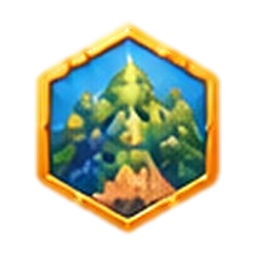 | badges/badge-milestone | `badge-milestone.png` |
|  | badges/badge-participation | `badge-participation.png` |
|  | badges/badge-persistence | `badge-persistence.png` |
|  | badges/badge-season | `badge-season.png` |
|  | badges/badge-shield-island | `badge-shield-island.png` |
|  | badges/badge-shield-lighthouse | `badge-shield-lighthouse.png` |
|  | badges/badge-shield-swimmer | `badge-shield-swimmer.png` |
|  | badges/badge-shield-wave | `badge-shield-wave.png` |
|  | badges/badge-teamwork | `badge-teamwork.png` |
|  | badges/badge-training | `badge-training.png` |

## art/mockup/brand

3 images.

| Thumbnail | Id | File |
|---|---|---|
| 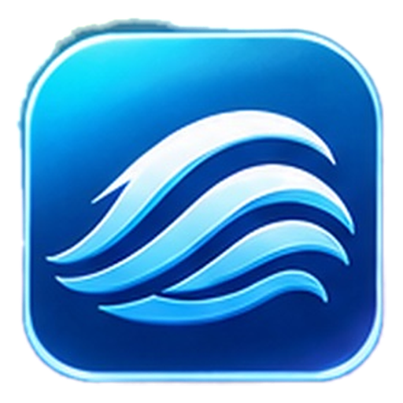 | brand/app-icon | `app-icon.png` |
| 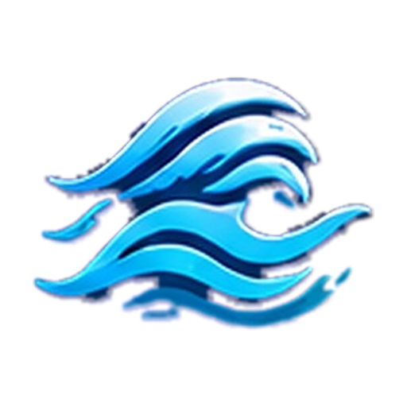 | brand/logo-mark | `logo-mark.png` |
|  | brand/logo | `logo.png` |

## art/mockup/characters

12 images.

| Thumbnail | Id | File |
|---|---|---|
| 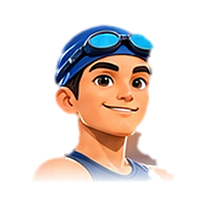 | characters/portrait-blue-cap | `portrait-blue-cap.png` |
| 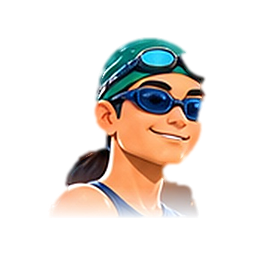 | characters/portrait-green-cap | `portrait-green-cap.png` |
| 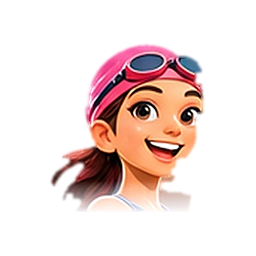 | characters/portrait-pink-cap | `portrait-pink-cap.png` |
|  | characters/portrait-senior | `portrait-senior.png` |
|  | characters/portrait-yellow-cap | `portrait-yellow-cap.png` |
| 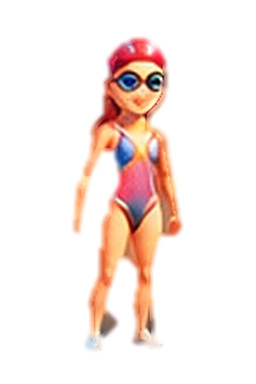 | characters/swimmer-female-basic | `swimmer-female-basic.png` |
| 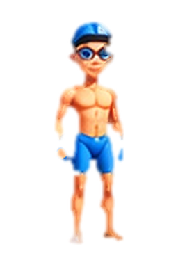 | characters/swimmer-male-basic-alt | `swimmer-male-basic-alt.png` |
| 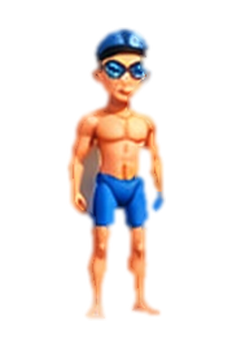 | characters/swimmer-male-basic | `swimmer-male-basic.png` |
| 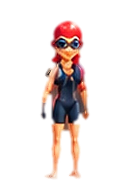 | characters/swimmer-outfit-black | `swimmer-outfit-black.png` |
| 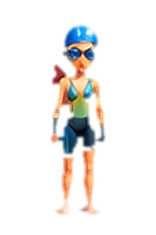 | characters/swimmer-outfit-green | `swimmer-outfit-green.png` |
| 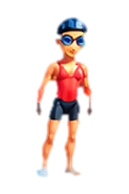 | characters/swimmer-outfit-red | `swimmer-outfit-red.png` |
| 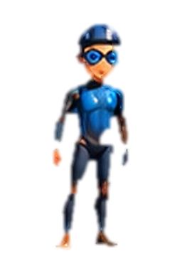 | characters/swimmer-wetsuit | `swimmer-wetsuit.png` |

## art/mockup/decor

5 images.

| Thumbnail | Id | File |
|---|---|---|
| 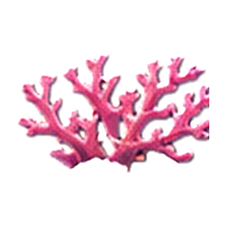 | decor/coral | `coral.png` |
| 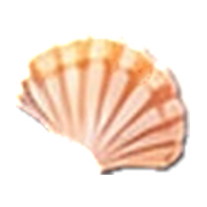 | decor/scallop-shell | `scallop-shell.png` |
| 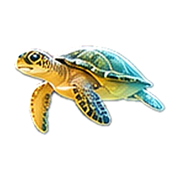 | decor/sea-turtle | `sea-turtle.png` |
| 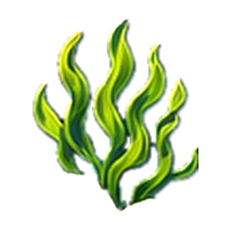 | decor/seaweed | `seaweed.png` |
| 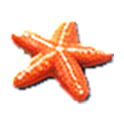 | decor/starfish | `starfish.png` |

## art/mockup/effects

13 images.

| Thumbnail | Id | File |
|---|---|---|
| 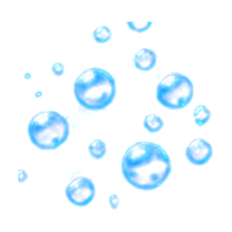 | effects/bubble | `bubble.png` |
| 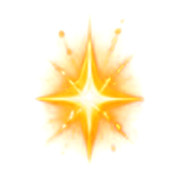 | effects/completion-burst | `completion-burst.png` |
| 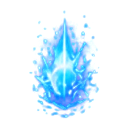 | effects/foam-burst | `foam-burst.png` |
|  | effects/glow | `glow.png` |
| 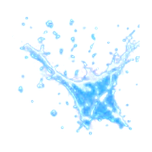 | effects/splash-burst | `splash-burst.png` |
| 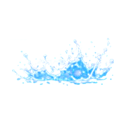 | effects/splash-medium | `splash-medium.png` |
| 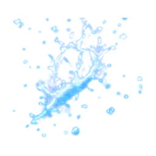 | effects/splash-ring | `splash-ring.png` |
| 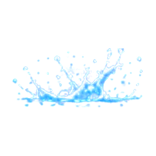 | effects/splash-small-2 | `splash-small-2.png` |
| 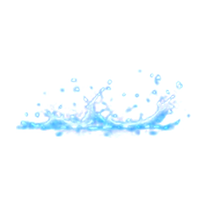 | effects/splash-small | `splash-small.png` |
| 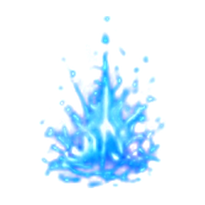 | effects/water-spark | `water-spark.png` |
| 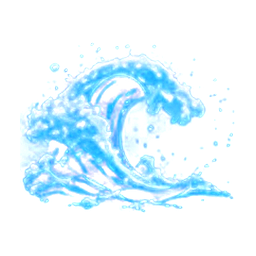 | effects/wave-curl | `wave-curl.png` |
| 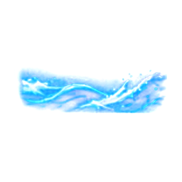 | effects/wave-trail | `wave-trail.png` |
| 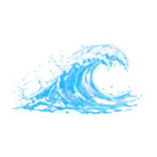 | effects/wave | `wave.png` |

## art/mockup/items

13 images.

| Thumbnail | Id | File |
|---|---|---|
| 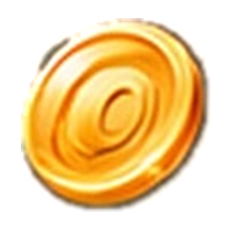 | items/coin | `coin.png` |
| 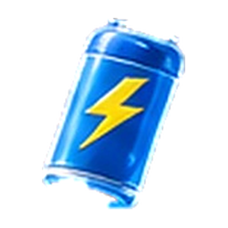 | items/energy-drink | `energy-drink.png` |
| 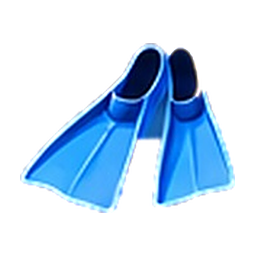 | items/fins | `fins.png` |
| 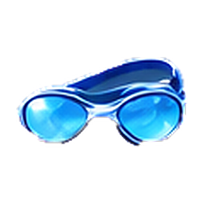 | items/goggles | `goggles.png` |
|  | items/med-kit | `med-kit.png` |
| 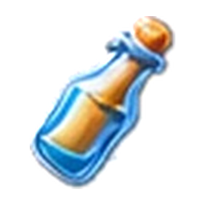 | items/message-bottle | `message-bottle.png` |
| 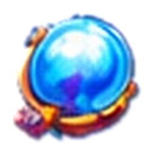 | items/pearl | `pearl.png` |
| 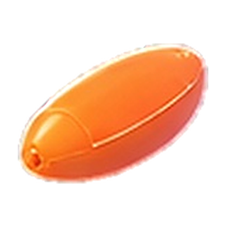 | items/rescue-buoy | `rescue-buoy.png` |
| 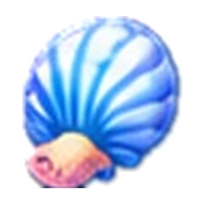 | items/seashell | `seashell.png` |
|  | items/star | `star.png` |
| 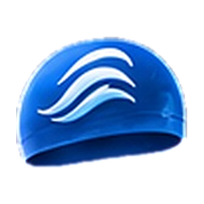 | items/swim-cap | `swim-cap.png` |
|  | items/treasure-chest | `treasure-chest.png` |
| 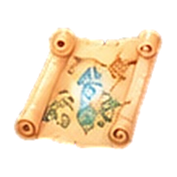 | items/treasure-map | `treasure-map.png` |

## art/mockup/landmarks

7 images.

| Thumbnail | Id | File |
|---|---|---|
| 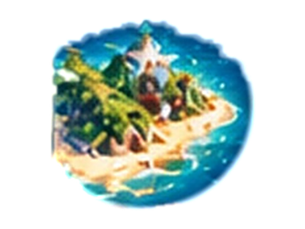 | landmarks/landmark-01-non-nuoc | `landmark-01-non-nuoc.png` |
| 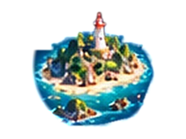 | landmarks/landmark-02-son-thuy | `landmark-02-son-thuy.png` |
| 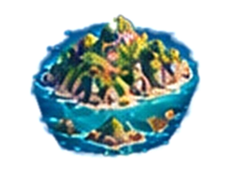 | landmarks/landmark-03-pham-van-dong | `landmark-03-pham-van-dong.png` |
| 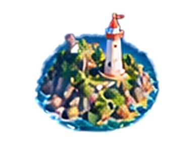 | landmarks/landmark-04-man-thai | `landmark-04-man-thai.png` |
| 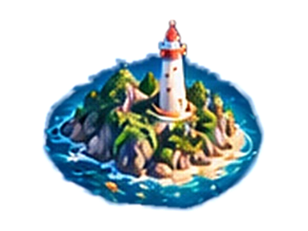 | landmarks/landmark-05-hon-sup | `landmark-05-hon-sup.png` |
| 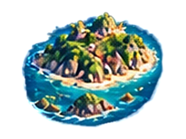 | landmarks/landmark-06-cu-lao-cham | `landmark-06-cu-lao-cham.png` |
| 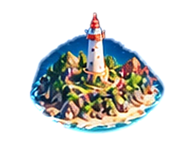 | landmarks/landmark-07-ly-son | `landmark-07-ly-son.png` |

## art/mockup/map

16 images.

| Thumbnail | Id | File |
|---|---|---|
| 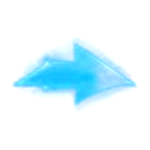 | map/arrow | `arrow.png` |
| 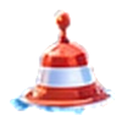 | map/buoy | `buoy.png` |
| 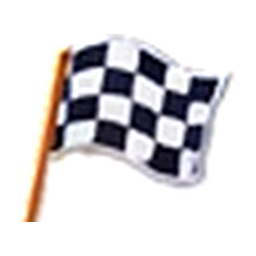 | map/checkered-flag | `checkered-flag.png` |
|  | map/cloud | `cloud.png` |
|  | map/compass-gold | `compass-gold.png` |
|  | map/compass-rose | `compass-rose.png` |
|  | map/flag | `flag.png` |
|  | map/location-pin | `location-pin.png` |
|  | map/route-dash | `route-dash.png` |
|  | map/route-dot | `route-dot.png` |
|  | map/route-pin-1 | `route-pin-1.png` |
|  | map/route-pin-2 | `route-pin-2.png` |
|  | map/route-pin-3 | `route-pin-3.png` |
|  | map/route-pin-4 | `route-pin-4.png` |
|  | map/ship-helm | `ship-helm.png` |
|  | map/treasure-chest | `treasure-chest.png` |

## art/mockup/marine

8 images.

| Thumbnail | Id | File |
|---|---|---|
|  | marine/clownfish | `clownfish.png` |
|  | marine/dolphin | `dolphin.png` |
|  | marine/fish-school | `fish-school.png` |
|  | marine/jellyfish | `jellyfish.png` |
|  | marine/ray | `ray.png` |
|  | marine/sea-turtle | `sea-turtle.png` |
|  | marine/tuna | `tuna.png` |
|  | marine/whale-shark | `whale-shark.png` |

## art/mockup/medals

6 images.

| Thumbnail | Id | File |
|---|---|---|
|  | medals/medal-bronze | `medal-bronze.png` |
|  | medals/medal-gold | `medal-gold.png` |
|  | medals/medal-silver | `medal-silver.png` |
|  | medals/trophy-rank-1 | `trophy-rank-1.png` |
|  | medals/trophy-rank-2 | `trophy-rank-2.png` |
|  | medals/trophy-rank-3 | `trophy-rank-3.png` |

## art/mockup/poses

19 images.

| Thumbnail | Id | File |
|---|---|---|
|  | poses/backstroke-01 | `backstroke-01.png` |
|  | poses/breaststroke-01 | `breaststroke-01.png` |
|  | poses/butterfly-01 | `butterfly-01.png` |
|  | poses/cheer-01 | `cheer-01.png` |
|  | poses/cheer-02 | `cheer-02.png` |
|  | poses/freestyle-01 | `freestyle-01.png` |
|  | poses/idle-01 | `idle-01.png` |
|  | poses/idle-02 | `idle-02.png` |
|  | poses/swim-front-01 | `swim-front-01.png` |
|  | poses/swim-front-02 | `swim-front-02.png` |
|  | poses/swim-front-03 | `swim-front-03.png` |
|  | poses/swim-side-01 | `swim-side-01.png` |
|  | poses/swim-side-02 | `swim-side-02.png` |
|  | poses/swim-side-03 | `swim-side-03.png` |
|  | poses/swim-stroke-01 | `swim-stroke-01.png` |
|  | poses/swim-stroke-02 | `swim-stroke-02.png` |
|  | poses/swim-stroke-03 | `swim-stroke-03.png` |
|  | poses/swim-stroke-04 | `swim-stroke-04.png` |
|  | poses/swim-stroke-05 | `swim-stroke-05.png` |

## art/mockup/scenes

25 images.

| Thumbnail | Id | File |
|---|---|---|
|  | scenes/beach-da-nang-16x9 | `beach-da-nang-16x9.png` |
|  | scenes/beach-da-nang-4x3 | `beach-da-nang-4x3.png` |
|  | scenes/beach-da-nang-9x16 | `beach-da-nang-9x16.png` |
|  | scenes/hero-swimmers-16x9 | `hero-swimmers-16x9.png` |
|  | scenes/hero-swimmers-4x3 | `hero-swimmers-4x3.png` |
|  | scenes/sea-cu-lao-cham-16x9 | `sea-cu-lao-cham-16x9.png` |
|  | scenes/sea-cu-lao-cham-4x3 | `sea-cu-lao-cham-4x3.png` |
|  | scenes/sea-cu-lao-cham-9x16 | `sea-cu-lao-cham-9x16.png` |
|  | scenes/sea-island-day-16x9 | `sea-island-day-16x9.png` |
|  | scenes/sea-island-day-4x3 | `sea-island-day-4x3.png` |
|  | scenes/sea-ly-son-16x9 | `sea-ly-son-16x9.png` |
|  | scenes/sea-ly-son-4x3 | `sea-ly-son-4x3.png` |
|  | scenes/sea-ly-son-9x16 | `sea-ly-son-9x16.png` |
|  | scenes/sea-night-16x9 | `sea-night-16x9.png` |
|  | scenes/sea-night-4x3 | `sea-night-4x3.png` |
|  | scenes/sea-sunset-16x9 | `sea-sunset-16x9.png` |
|  | scenes/sea-sunset-4x3 | `sea-sunset-4x3.png` |
|  | scenes/sunrise-coast-16x9 | `sunrise-coast-16x9.png` |
|  | scenes/sunrise-coast-4x3 | `sunrise-coast-4x3.png` |
|  | scenes/sunrise-coast-9x16 | `sunrise-coast-9x16.png` |
|  | scenes/sunset-coast-16x9 | `sunset-coast-16x9.png` |
|  | scenes/sunset-coast-4x3 | `sunset-coast-4x3.png` |
|  | scenes/sunset-coast-9x16 | `sunset-coast-9x16.png` |
|  | scenes/underwater-reef-16x9 | `underwater-reef-16x9.png` |
|  | scenes/underwater-reef-4x3 | `underwater-reef-4x3.png` |

## art/mockup/screen-finish

1 images.

| Thumbnail | Id | File |
|---|---|---|
|  | no id | `finish-emblem.png` |

## art/mockup/screen-home

2 images.

| Thumbnail | Id | File |
|---|---|---|
|  | no id | `home-hero.png` |
|  | no id | `tournament-thumb.png` |

## art/mockup/screen-swims

1 images.

| Thumbnail | Id | File |
|---|---|---|
|  | no id | `wave-band.png` |

## art/mockup/screen-team

6 images.

| Thumbnail | Id | File |
|---|---|---|
|  | no id | `member-1.png` |
|  | no id | `member-2.png` |
|  | no id | `member-3.png` |
|  | no id | `member-4.png` |
|  | no id | `member-5.png` |
|  | no id | `team-emblem-swirl.png` |

## art/mockup/ships

12 images.

| Thumbnail | Id | File |
|---|---|---|
|  | ships/boat-team-blue | `boat-team-blue.png` |
|  | ships/boat-team-purple | `boat-team-purple.png` |
|  | ships/boat-team-red | `boat-team-red.png` |
|  | ships/ship-tier-1-small-alt | `ship-tier-1-small-alt.png` |
|  | ships/ship-tier-1-small | `ship-tier-1-small.png` |
|  | ships/ship-tier-1 | `ship-tier-1.png` |
|  | ships/ship-tier-2-small | `ship-tier-2-small.png` |
|  | ships/ship-tier-2 | `ship-tier-2.png` |
|  | ships/ship-tier-3-small | `ship-tier-3-small.png` |
|  | ships/ship-tier-3 | `ship-tier-3.png` |
|  | ships/ship-tier-4-small | `ship-tier-4-small.png` |
|  | ships/ship-tier-4 | `ship-tier-4.png` |

## art/route01

1 images.

| Thumbnail | Id | File |
|---|---|---|
|  | no id | `map.svg` |

## art/route01/landmarks

7 images.

| Thumbnail | Id | File |
|---|---|---|
|  | no id | `cu_lao_cham.svg` |
|  | no id | `hon_sup.svg` |
|  | no id | `ly_son.svg` |
|  | no id | `man_thai.svg` |
|  | no id | `non_nuoc.svg` |
|  | no id | `pham_van_dong.svg` |
|  | no id | `son_thuy.svg` |

## art/ships

3 images.

| Thumbnail | Id | File |
|---|---|---|
|  | no id | `ship-tier-1.svg` |
|  | no id | `ship-tier-2.svg` |
|  | no id | `ship-tier-3.svg` |

## icons

3 images.

| Thumbnail | Id | File |
|---|---|---|
|  | no id | `icon-192.png` |
|  | no id | `icon-512.png` |
|  | no id | `maskable-512.png` |
