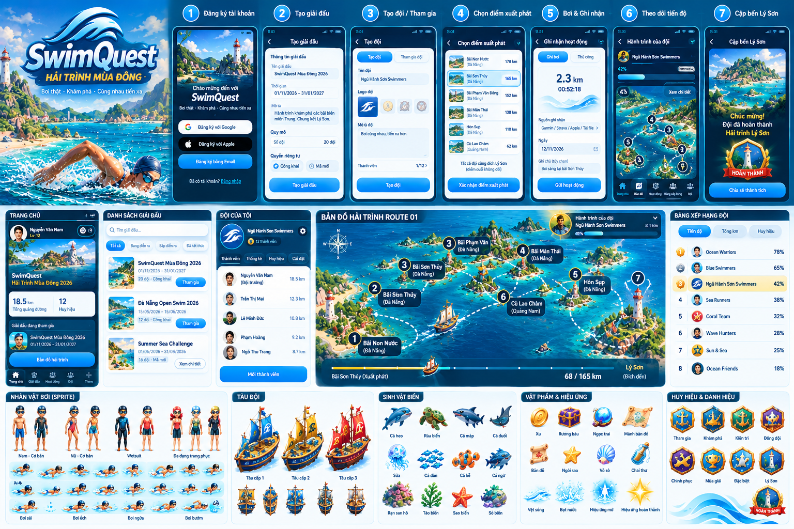

# Image: swimquest_full_platform_ui_concept.png

## Description (written by the BA from the image)

A single 1536x1024 composite concept board (visual direction only, per README and manifest).
All on-image text is **Vietnamese**; English translations are given in parentheses.
The board has three horizontal bands.

### Band 1 (top): brand hero + 7-step mobile flow
- **Hero (left):** "SwimQuest" wordmark with subtitle "Hải trình mùa đông" (Winter voyage) and
  tagline "Bơi thật · Khám phá · Cùng nhau tiến xa" (Swim for real · Explore · Go far together).
  Painterly beach/lighthouse scene with a swimmer in a cap and goggles doing freestyle.
- Seven numbered phone mockups, each with a step title:
  1. **Đăng ký tài khoản (Register account):** welcome screen "Chào mừng đến với SwimQuest";
     buttons "Đăng ký với Google" (Sign up with Google), "Đăng ký với Apple" (Sign up with Apple),
     "Đăng ký bằng Email" (Sign up with email); link "Đã có tài khoản? Đăng nhập" (Already have an
     account? Log in). **No Strava button is shown.**
  2. **Tạo giải đấu (Create tournament):** fields "Tên giải đấu" (name) = "SwimQuest Mùa Đông
     2026"; "Thời gian" (time) = 01/11/2026 - 31/01/2027; "Mô tả" (description) = "Hành trình khám
     phá các bãi biển miền Trung. Chung kết Lý Sơn." (A journey exploring central Vietnam beaches.
     Finale at Lý Sơn.); "Quy mô" (scale) "Số đội" (number of teams) = 20 đội (20 teams);
     "Quyền riêng tư" (privacy) radio: "Công khai" (Public) / "Mã mời" (Invite code); button
     "Tạo giải đấu" (Create tournament). Only one date range is shown (no separate registration
     window).
  3. **Tạo đội / Tham gia (Create team / Join):** tabs "Tạo đội" (Create team) / "Tham gia đội"
     (Join team); "Tên đội" (team name) = "Ngũ Hành Sơn Swimmers"; "Logo đội" (team logo) picker
     with 4 emblem options; "Mô tả đội" (team description) = "Bơi cùng nhau, tiến xa hơn." (Swim
     together, go further.); "Thành viên 1/12" (Members 1/12); button "Tạo đội".
  4. **Chọn điểm xuất phát (Choose start point):** list of six starts with a thumbnail, province
     and a distance: Bãi Non Nước (Đà Nẵng) 178 km; Bãi Sơn Thủy (Đà Nẵng) 165 km (highlighted as
     selected); Bãi Phạm Văn Đồng (Đà Nẵng) 152 km; Bãi Mân Thái (Đà Nẵng) 138 km; Hòn Sụp (Đà
     Nẵng) 110 km; Cù Lao Chàm (Quảng Nam) 62 km. Footer: "Tất cả đội cùng đích Lý Sơn (điểm cuối
     không đổi)" (All teams share the Lý Sơn finish (fixed end point)); button "Xác nhận điểm xuất
     phát" (Confirm start point).
  5. **Bơi & Ghi nhận (Swim & Record):** screen "Ghi nhận hoạt động" (Record activity) with tabs
     "Ghi bơi" (Record swim) / "Thủ công" (Manual); shows 2.3 km and 00:52:18; "Nguồn ghi nhận"
     (Recording source) = "Garmin / Strava / Apple / Tải file" (Garmin / Strava / Apple / Upload
     file); "Ngày" (Date) 12/11/2026; "Ghi chú (tùy chọn)" (Note, optional) = "Bơi sáng tại bãi Sơn
     Thủy" (Morning swim at Sơn Thủy beach); button "Gửi hoạt động" (Submit activity).
  6. **Theo dõi tiến độ (Track progress):** "Hành trình của đội" (Team journey) for Ngũ Hành Sơn
     Swimmers, 42% progress bar, mini map with numbered stops, "Xem chi tiết" (See details). Bottom
     nav: Trang chủ (Home), Bản đồ (Map), Hoạt động (Activity), Bảng xếp hạng (Leaderboard), Đội
     (Team).
  7. **Cập bến Lý Sơn (Arrive at Lý Sơn):** "Chúc mừng! Đội đã hoàn thành Hải trình Lý Sơn"
     (Congratulations! The team completed the Lý Sơn voyage); "HOÀN THÀNH" (COMPLETED) badge with
     a lighthouse; button "Chia sẻ thành tích" (Share achievement).

### Band 2 (middle): desktop/tablet panels
- **Trang chủ (Home):** user "Nguyễn Văn Nam", "Lv 12" (level 12); hero card "SwimQuest Hải Trình
  Mùa Đông 2026"; stats "18.5 km Tổng quãng đường" (total distance) and "12 Huy hiệu" (badges);
  "Giải đấu đang tham gia" (Tournaments joined) card; button "Bản đồ hải trình" (Voyage map).
  Bottom nav: Trang chủ (Home), Giải đấu (Tournaments), Hoạt động (Activity), Đội (Team), Thêm
  (More).
- **Danh sách giải đấu (Tournament list):** search "Tìm giải đấu..."; filter chips "Tất cả" (All),
  "Đang diễn ra" (Ongoing), "Sắp diễn ra" (Upcoming), "Đã kết thúc" (Ended). Cards:
  "SwimQuest Mùa Đông 2026" 01/11/2026-31/01/2027, 20 đội, Công khai (20 teams, Public), "Tham gia"
  (Join); "Đà Nẵng Open Swim 2026" 15/05/2026-15/06/2026, 12 đội, Công khai; "Summer Sea Challenge"
  01/06/2026-31/08/2026, 16 đội, Mã mời (Invite code), "Xem chi tiết" (View details).
- **Đội của tôi (My team):** "Ngũ Hành Sơn Swimmers", 12 thành viên (members); tabs Thành viên
  (Members), Thống kê (Stats), Huy hiệu (Badges), Cài đặt (Settings); roster with each member's
  km: Nguyễn Văn Nam (Đội trưởng / Captain) 18.5 km, Trần Thị Mai 12.3 km, Lê Minh Đức 10.8 km,
  Phạm Hoàng 9.2 km, Ngô Thu Trang 8.7 km; button "Mời thành viên" (Invite member).
- **Bản đồ hải trình Route 01 (Route 01 voyage map):** stylized islands map with compass; numbered
  markers 1 Bãi Non Nước, 2 Bãi Sơn Thủy, 3 Bãi Sơn Thủy (duplicate label, likely an art error),
  3 Bãi Phạm Văn [Đồng], 4 Bãi Mân Thái, 5 Hòn Sụp, 6 Cù Lao Chàm (Quảng Nam), 7 (Lý Sơn
  lighthouse); a team ship on dashed route lines. Overlay "Hành trình của đội" (Team journey) 42%.
  Bottom bar: "Bãi Sơn Thủy (Xuất phát)" (start) → "Lý Sơn (Đích đến)" (finish), "68 / 165 km"
  (raw km against the start's distance, not a percentage).
- **Bảng xếp hạng đội (Team leaderboard):** tabs "Tiến độ" (Progress), "Tổng km" (Total km),
  "Huy hiệu" (Badges); ranks by %: Ocean Warriors 78%, Blue Swimmers 65%, Ngũ Hành Sơn Swimmers
  42% (highlighted), Sea Runners 38%, Coral Team 32%, Wave Hunters 28%, Sun & Sea 25%, Ocean
  Friends 18%.

### Band 3 (bottom): game asset concepts
- **Nhân vật bơi (sprite) (Swimmer characters):** Nam - Cơ bản (male basic), Nữ - Cơ bản (female
  basic), Wetsuit, Đa dạng trang phục (diverse outfits); stroke rows: Bơi sải (freestyle), Bơi ếch
  (breaststroke), Bơi ngửa (backstroke), Bơi bướm (butterfly).
- **Tàu đội (Team ships):** Tàu cấp 1/2/3 (ship tier 1/2/3) plus smaller ship variants.
- **Sinh vật biển (Marine life):** Cá heo (dolphin), Rùa biển (sea turtle), Cá mập (shark), Cá đuối
  (ray), Sứa (jellyfish), Cá dàn/đàn (fish school), Cá hề (clownfish), Cá ngừ (tuna), Rạn san hô
  (coral reef), Tảo biển (seaweed), Sao biển (starfish), Sò biển (sea shell).
- **Vật phẩm & hiệu ứng (Items & effects):** Xu (coin), Rương báu (treasure chest), Ngọc trai
  (pearl), Mảnh bản đồ (map fragment), Bản đồ (map), Ngôi sao (star), Vỏ sò (shell), Chai thư
  (message bottle); Vệt sóng (wave trail), Bọt nước (splash), Hiệu ứng mở (open effect), Hiệu ứng
  hoàn thành (completion effect).
- **Huy hiệu & danh hiệu (Badges & titles):** Tham gia (Participation), Khám phá (Explorer), Kiên
  trì (Perseverance), Đồng đội (Teamwork), Chinh phục (Conqueror), Mùa giải (Season), Đặc biệt
  (Special), Lý Sơn; plus a "HOÀN THÀNH" (Completed) emblem.

### BA observations (differences from the written specs)
- Sign-in options Google/Apple/Email; the specs say email/password + optional Strava.
- Bottom navigation differs from the spec (Home, Tournaments, My Team, Voyage, Profile) and differs
  between panels of the board itself.
- Start points carry concrete km distances (62 to 178 km) and progress is shown as "68 / 165 km".
- Tournament form uses "number of teams" and Public/Invite-code privacy, not the spec's fields.
- 8 badges shown vs 4 in the art plan; butterfly stroke shown but not in the art plan.
- Activity intake shows manual entry and Garmin/Strava/Apple/file sources.
- UI copy is Vietnamese.
